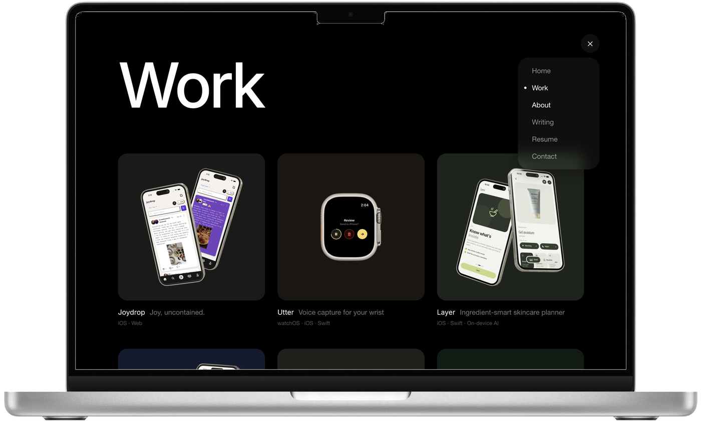
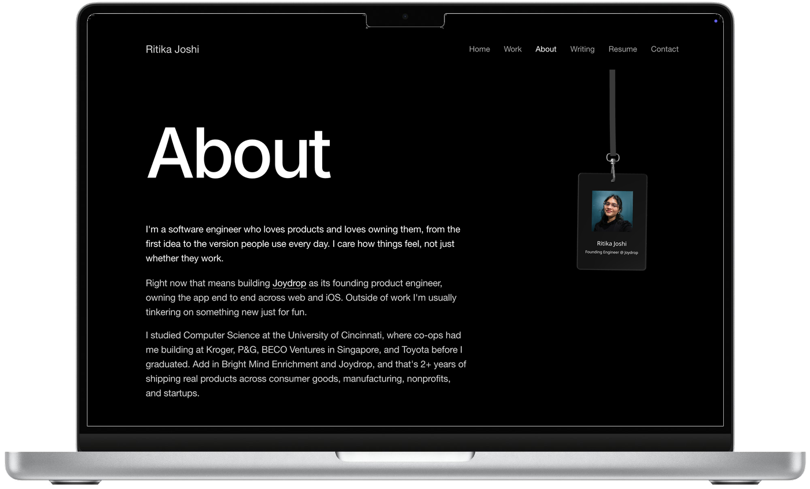
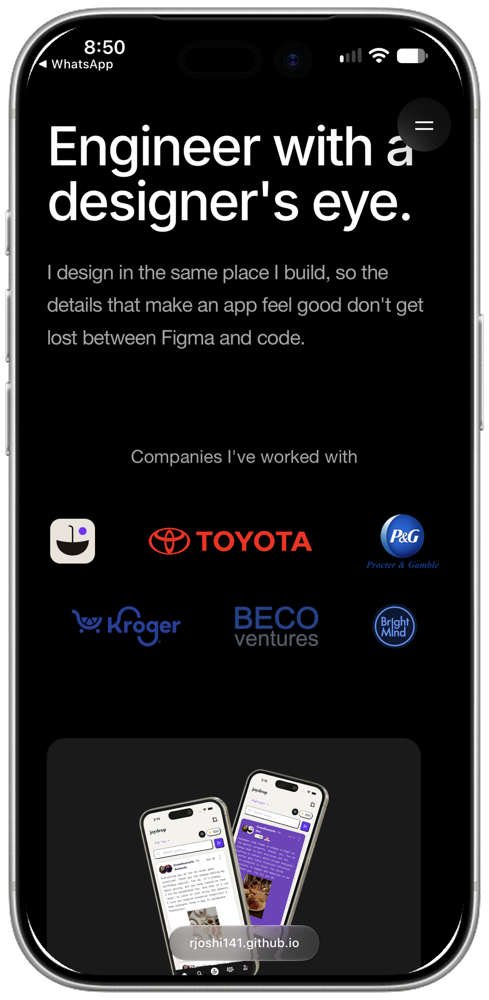
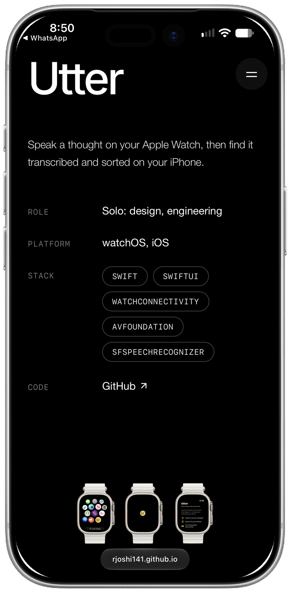

<div align="center">
  
  <h1>Ritika's Portfolio</h1>
  <p>A work-first portfolio: case studies with real screen recordings, device frames and the code behind each feature.</p>

  <a href="https://rjoshi141.github.io/portfolio-v2/">rjoshi141.github.io/portfolio-v2</a>
  <br /><br />

  
  
  
  
  
  
</div>

## Screens

<div align="center">
  
  
  <br /><br />
  
  &nbsp;&nbsp;
  
</div>

## What this is

The source for my personal site. It leads with the work: every project gets a case study with looping screen recordings inside device frames, the design decisions, and the real code behind the interesting parts. Everything is custom built. No templates, no component library for layout.

## Pages

| Page | Route | What's on it |
| --- | --- | --- |
| **Home** | `#/` | Headline, companies I've worked with, a rail of featured case studies, contact |
| **Work** | `#/work` | Every project as a card. Cards can play a looping demo or open an external site |
| **Case study** | `#/work/:slug` | Big title, role and stack, then story sections with media and numbered code steps |
| **About** | `#/about` | Intro, a draggable 3D lanyard ID card, and each role with what I did there |
| **Writing** | `#/writing` | Articles and talks |
| **Resume** | `#/resume` | The PDF in-page with a download button, and an image preview on mobile |

The previous version of the site still lives at [`/classic`](https://rjoshi141.github.io/portfolio-v2/classic/).

## Case studies

Joydrop, Utter, Layer, Even, Zoomies and an iPhone Duo study, among others. All of them are driven by one file, `src/revamp/data/projects.js`. A case study can mix:

- **Device demos:** portrait and landscape iPhone, Apple Watch and MacBook frames, each with a screen recording fitted to the frame's measured screen box
- **Text beside a phone:** copy on one side, a looping recording on the other
- **Before and after rows:** screenshots side by side with captions
- **Code steps:** numbered steps with real code and a small syntax highlighter
- **Design panels:** color swatches, type samples, sprite sheets and asset shelves
- **Results:** a row of headline numbers

Every grey media panel opens in a lightbox that grows out of its spot on the page. Arrow keys step through all the panels in order.

## Notable features

**3D lanyard:** a physics-simulated ID card on the About page, built with React Three Fiber and Rapier. You can grab it and swing it around. It loads lazily and hides itself if the browser can't do WebGL.

**Floating nav:** a capsule menu that stays pinned to the right edge of the content as you scroll.

**Lightbox:** a shared-element zoom built with Framer Motion. The panel scales from its exact spot on the page and flies back on close.

## Tech stack

| Layer | Tech |
| --- | --- |
| Framework | React 19 + Vite |
| Styling | Tailwind CSS |
| Animation | Framer Motion |
| 3D | Three.js, React Three Fiber, Rapier physics |
| Media | ffmpeg-compressed MP4 loops with first-frame posters |
| Deployment | GitHub Pages via `gh-pages` |

## Getting started

```bash
# install dependencies
npm install

# start the dev server
npm run dev

# production build
npm run build

# build and publish to GitHub Pages
npm run deploy
```

## Repo structure

```
index.html              # the site (mounts src/revamp)
classic/index.html      # the previous version of the site
src/
├── revamp/
│   ├── RevampApp.jsx    # layout, routes, nav and footer
│   ├── useHashRoute.js  # tiny hash router
│   ├── pages/           # Home, Work, CaseStudy, About, Writing, Resume
│   ├── components/      # Nav, Footer, ProjectCard, Lightbox, Companies, Contact
│   └── data/
│       ├── projects.js  # every project and case study
│       └── content.js   # experience, writing, socials
├── components/          # shared pieces, like the 3D Lanyard
└── assets/
    └── case-studies/    # screenshots, recordings and device frames per project
public/
├── Resume.pdf
└── resume-preview-v2.png
docs/screenshots/        # images for this README
```

## Adding a project

Add an entry to `src/revamp/data/projects.js` with a `slug`, `name`, `tagline`, `tags` and a card image (`frame`) or a `cardDemo`. Give it `sections` for a full case study, or a `link` to send the card straight to an external site. Put its media in `src/assets/case-studies/<slug>/`.
